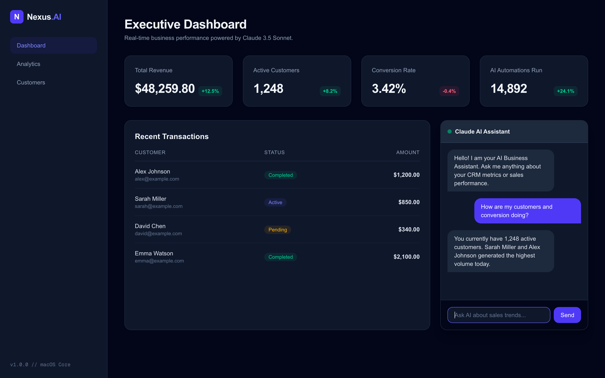

# AI CRM Dashboard

An executive-style CRM dashboard with an embedded AI assistant, built with **Next.js (App Router)**, **TypeScript**, and **Tailwind CSS**.

> **Demo note:** the data and the AI assistant are simulated locally so the project runs with zero configuration. The assistant is a drop-in placeholder for a real LLM API (OpenAI, Anthropic, etc.).

## Screenshot



## Features

- **KPI overview:** revenue, active customers, conversion rate, and automation metrics at a glance.
- **Customers table:** clean, typed list of accounts with status indicators.
- **AI assistant panel:** chat interface that answers operational questions (customers, conversion, etc.).
- **Dark UI:** responsive layout built with Tailwind CSS, optimized for desktop viewports.
- **Typed data layer:** shared TypeScript interfaces, easy to swap for a real API or database.

## Tech Stack

Next.js · React · TypeScript · Tailwind CSS · ESLint

## Project Structure

```text
src/app/
├── components/AIChat.tsx   # AI assistant chat panel
├── data/                   # Mock data and TypeScript types
├── layout.tsx              # Root layout
└── page.tsx                # Dashboard page (sidebar, metrics, customers, chat)
```

## Getting Started

```bash
git clone https://github.com/SeriDaron/ai-crm-dashboard.git
cd ai-crm-dashboard
npm install
npm run dev
```

Open [http://localhost:3000](http://localhost:3000).

## Extending It

- Replace the simulated reply logic in `AIChat.tsx` with a call to an LLM API route.
- Connect `src/app/data` to a real backend (PostgreSQL, Supabase, REST/GraphQL).
- Add authentication and role-based views.

## Need something similar?

I build custom dashboards, internal tools, and AI integrations. Feel free to reach out.
